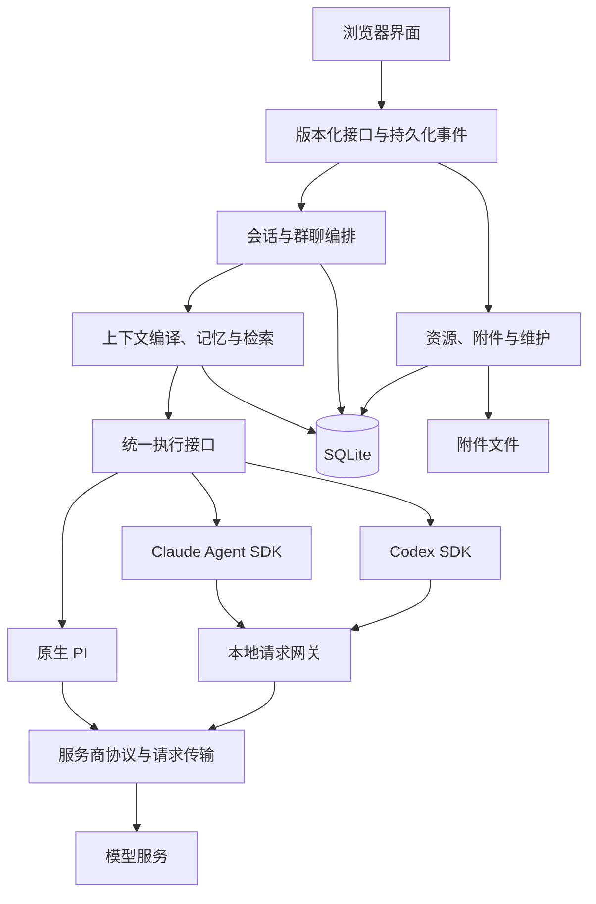

# Conversation v1

本项目提供独立的角色对话系统。`npm start` 启动 `src/conversation/server.js`，根路径进入 `/modern/conversation/`。服务端负责生成、工具、记忆和持久化，浏览器只负责交互与事件恢复。

## 功能

- 对话：发送、重新生成、续写、代写、群聊、停止生成、流式恢复，以及草稿、候选回复和历史版本管理。
- 资源：角色、用户人设、预设、世界书、群组与模型连接；支持宏、正则处理和文本模板。
- 记忆：自动与手动摘要、结构化记忆、锁定、压缩、折叠和展开；结合关键词与可选向量检索，源内容变更后检查依赖是否失效。
- 工具与媒体：共享工具注册、附件、图片生成及任务查询、取消和结果复用；具体媒体能力由连接声明决定。
- 诊断与维护：上下文来源、请求轨迹、实际与估算用量、备份恢复、索引重建和有预览确认的清理。

## 三种执行器

三种执行器共用服务端的会话、上下文、工具和持久化接口，SDK 临时会话不作为业务历史。

| 执行器 | 接入方式 | 平台限制 |
| --- | --- | --- |
| 原生 PI | pi 模型与工具循环，服务商协议适配 | 不依赖 SDK 的 macOS 隔离后端；具体能力以连接检查为准 |
| Claude Agent SDK | 统一适配层、本地请求网关、共享工具 | 内置 SDK 隔离后端目前仅支持 macOS |
| Codex SDK | 统一适配层、本地请求网关、共享工具 | 内置 SDK 隔离后端目前仅支持 macOS |

SDK 的每次模型请求经过历史适配、预算检查、取消控制和轨迹记录。服务商、模型和协议组合的可用性需要分别验证，不能由执行器安装成功推定。

## 安装与启动

要求 Node.js 22.19 或更新版本。执行：

```sh
npm ci
npm start
```

默认监听 `127.0.0.1:8000`，数据写入 `data/default-user/conversation-v1/`。可用 `node server.js --port 8001 --dataRoot /absolute/new-data` 更换端口和数据根目录。数据根目录下仍使用 `default-user/conversation-v1`。

启动后打开 [本机对话界面](http://127.0.0.1:8000/modern/conversation/)。`GET /health` 返回服务健康状态。`start.sh` 和 `Start.bat` 只启动应用，不自动安装依赖或更新 Git。重启时先向当前服务发送 `SIGTERM` 或在前台按 `Ctrl+C`，等进程退出后再启动；同一个数据目录只允许一个服务进程使用。

远程监听需设置 `CONVERSATION_PASSWORD`，并通过 `--host` 和 `--allowed-host` 明确配置监听地址及浏览器访问的主机名。界面使用 HTTP Basic 密码认证；对外部署请在受信任的 HTTPS 反向代理之后运行。默认本机访问无需密码。写接口同时校验同源请求与请求安全令牌。

## 首次使用

打开“资源”创建连接、角色、用户人设、预设、世界书或群组。在连接内设置执行器、服务商、模型、上下文窗口、输入/输出上限和工作预算。凭据仅在服务端保存。

新建会话并在设置里选择资源。先检查连接能力，再发送消息。默认原生执行器采用 pi 的模型与工具循环；Claude Agent SDK 和 Codex SDK 使用统一适配层及本地请求网关。

记忆页提供摘要、结构化记忆、锁定和压缩；诊断页提供编译上下文、来源、请求轨迹和用量；维护页提供备份、恢复、检索重建和清理预览。每项能力的可用性取决于连接与平台声明，真实服务商验证状态须单独查看。

## 架构与约束

- [架构与模块边界](docs/conversation/ARCHITECTURE.md)
- [协议契约](docs/conversation/CONTRACTS.md)
- [运行、恢复与维护](docs/conversation/OPERATIONS.md)
- [实施和提交阶段](docs/conversation/IMPLEMENTATION.md)
- [验收证据与剩余限制](docs/conversation/VALIDATION.md)
- [旧实现清理与功能保留核对](docs/conversation/CLEANUP.md)
- [可选离线评测工具（默认禁用付费）](tests/conversation/evaluation/README.md)

新数据库是对话事实的唯一持久化来源。消息版本、候选、快照、事件、资源版本与工具记录分别持久化。同一对话最多一个活动轮次；模型调用期间不持有数据库事务。



源码按职责分为 `src/conversation/`（服务端）、`public/shared/conversation/`（共享协议和纯上下文编译）、`public/modern/conversation/`（界面）和 `tests/conversation/`（测试）。

这是新数据格式。入口不读取旧配置或旧聊天目录，也不执行迁移、隐藏页面或旧生成桥接。旧前后端、旧插件加载器、旧配置初始化和迁移、旧构建与发布脚本均不属于本项目。只保留当前应用的源码、测试和实际使用的资源。

数据库只接受空库或当前存储布局版本 `3`，不兼容其他布局。备份协议版本与数据库布局版本分别管理。已有本地聊天、凭据和备份不会自动导入或删除；新工作区需要在资源界面配置连接。备份恢复须使用空的新工作区，操作要求见运行文档。

## 验证

开发阶段只执行相关模块单测，按阶段提交。所有功能代码就绪后才运行集成、故障与浏览器验证。真实连接只做经授权的最小可用性检查。长对话质量、预算上限和重复付费评测已取消，不作为交付前提；评测脚本默认禁止付费，模拟结果不能代表真实质量。

```sh
npm run lint:conversation
npm run test:conversation:unit
npm run test:conversation:integration
```

测试使用临时目录和模拟服务商，不读取真实用户数据。已执行检查和未验证限制记录在实施状态文档中。

2026-10-11 清理后的验证：649 项离线功能单测及源码 lint 通过；集成首轮 57 项通过、1 项失败，修正测试中已移除的请求字段后，相关 16 项 HTTP 集成测试全部通过。三种执行器此前各完成一次真实短回复检查。本轮清理未重跑浏览器验证和 Docker 构建；这些结果不代表所有服务商组合或长对话质量已经验证。详细证据见 [清理核对记录](docs/conversation/CLEANUP.md)。
