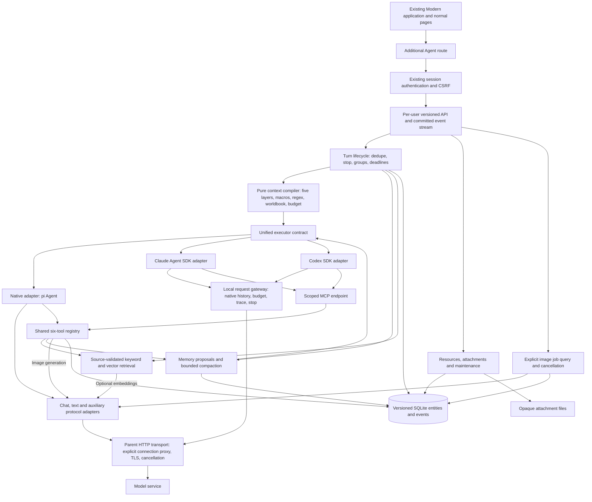

# Additive Agent architecture in the Modern application

The original Modern application remains the default product. Its normal pages, APIs, configuration and data flows remain available; Agent is an additional shell route. The Agent server modules own Agent conversation state and generation. The browser submits versioned commands and reads committed snapshots/events. One composition root connects pure compilation, transactional persistence and external adapters.

## Ownership

`public/shared/conversation` is pure, deterministic context compilation. It returns effects as proposals; it cannot write variables, worldbook state or memory. Input budgets reserve output and safety capacity. Required history exceeding the budget triggers bounded foreground compression rather than silent truncation.

`src/conversation/store` is the sole Agent business writer. SQLite commits resource/message revisions, selected candidates, active-turn ownership and events atomically. Streaming changes one turn and appends an event, without serializing the complete retained conversation. File attachments use opaque identifiers and hashes; backup captures the database export and attachment bytes together while generation is idle.

`runtime` owns business turns. The SDK owns its model/tool loop. Every model step passes a budget/stop check. The runtime persists deltas before exposing events, binds tools to the frozen turn/member context, and commits terminal results exactly once. Group member replies commit separately; their variable/worldbook effects remain temporary until the parent succeeds. All members share one frozen successful-turn counter. Stopping preserves completed messages and current partial output without committing temporary effects.

`memory` computes bounded proposals outside transactions. Commits recheck source message/candidate versions, summary dependencies, memory locks and resource revisions. Background proposals wait while a conversation is active; proposal persistence and job completion share one transaction. Foreground compaction prepares at most two speculative passes, recompiles their combined snapshot, and commits only after it fits. It folds complete earlier turns only; current and latest complete turns remain available. `retrieval` derives rebuildable indexes and checks sources again after asynchronous embedding.

## Three execution paths

The common `runTurn` interface carries compiled context, frozen connection, tool definitions, limits, cancellation and callbacks. Native execution uses pi with provider-specific streaming codecs. Claude Agent SDK and Codex SDK use per-turn temporary sessions, scoped tools and a local HTTP gateway. The gateway expands an explicit history marker into the model protocol's native role messages, retains the SDK's current tool continuation, and checks each actual outbound request.

SDK session files are disposable execution caches. They never become business history. Unknown or unavailable platform/provider combinations are reported explicitly. The built-in SDK isolation backend currently requires macOS; Linux/Windows SDK support remains unavailable. Protocol unit tests, local SDK execution and real provider verification are separate evidence levels; current evidence lives in IMPLEMENTATION.md.

## Public boundary

Default startup is `server.js` → `src/workspace-bootstrap.js` → `src/server-main.js`, with the original `CommandLineParser`, configuration, authentication, CSRF and normal endpoints. `/` enters `/modern/`; its `agent` route adds the new interface without replacing normal chat or resource pages. `src/conversation/host.js` mounts `/api/conversation/v1` after existing authentication/CSRF and derives each workspace from `req.user.directories.root/conversation-v1`. Client-supplied user IDs cannot select another workspace.

Agent does not import old chats or use them as its database. This isolation does not disable the original application's normal config initialization, data maintenance or generation paths. `src/conversation/store` is the writer for Agent business state, not for the entire application.

The optional `conversation-server.js` standalone entry has its own limited static routes, password/Host/Origin controls and health endpoint. Those standalone rules do not replace the main application's security policy. Keep standalone and full-app processes on separate ports and Agent data directories.

The browser has no model credentials, database writer or SDK session ownership. It reconnects with persisted event sequence numbers, deduplicates deltas and reloads authoritative state when continuity cannot be established. Manual changes use the relevant content or memory revision rather than overwriting an entire stale snapshot.

## Recovery, edits and accounting

Unknown paid-tool outcomes stop the model loop and prevent successful turn
commit. Explicit job recovery uses the persisted remote handle and frozen
connection revision. A recovered result is saved as registered attachments;
the old turn remains failed/interrupted. Retrying that operation can reuse its
completed image without another provider submission.

Committed history/resource events schedule semantic reindexing outside database
transactions. Semantic failures preserve keyword retrieval and are visible in
the interface. User hiding applies to raw history and dependent summaries during
normal generation, recall and automatic compression; fold expansion is separate.
Manual summary edits use block revisions and invalidate dependent derived data.

All execution and auxiliary paths share explicit connection transports and
reported usage contracts. Proxy secrets remain parent-only. Currency accounting
preserves reported versus estimated sources, and any missing amount stays unknown.
Maintenance can remove eligible details while retaining the records needed to
reconcile calls and usage.
